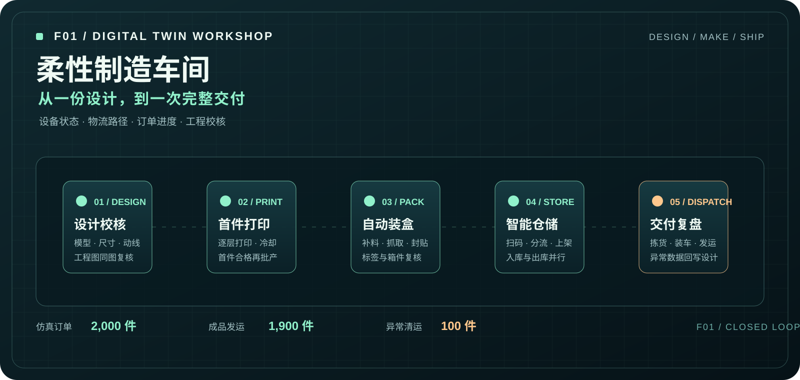
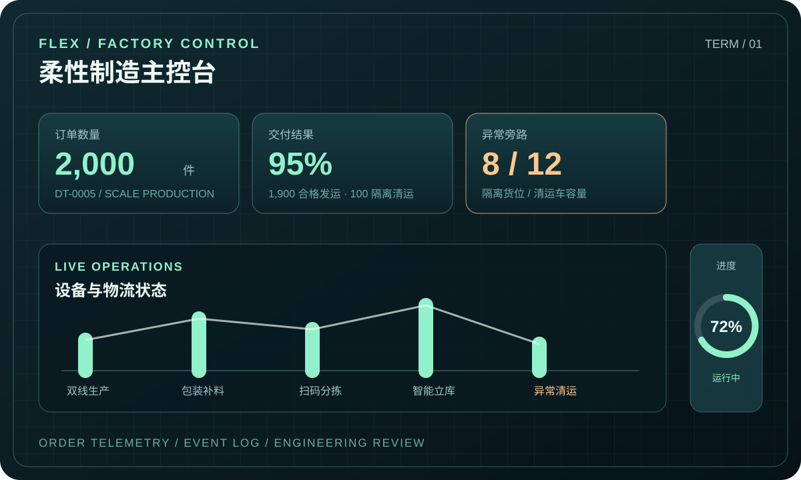

# 柔性定制制造车间 · 3D 数字孪生

这是一个基于 Vite、Three.js 和 WebGL 2 的交互式柔性制造车间演示。场景覆盖设计、打印、质检、包装、仓储、异常隔离和发运，设备状态、物流路径、工时、耗材与订单流程均由本地仿真驱动。

## 项目概览

<p align="center">
  
</p>

主控台把订单、设备、仓储、异常和工程复盘放在同一套数字孪生流程里。

<p align="center">
  
</p>

## 快速开始

环境要求

- Node.js 20.19 及以上，或 Node.js 22.12 及以上
- 支持 WebGL 2 的桌面浏览器

安装依赖并启动开发服务器

```sh
npm ci
npm run dev
```

打开终端输出的本地地址，默认是 `http://127.0.0.1:5173/`。

## 功能概览

- 旋转、缩放和浏览完整 3D 厂区
- 从设计办公室、打印区、包装区、仓储区和发运区定位设备
- 在监控室查看订单指标、设备状态、物流状态和事件日志
- 演示单件定制、240 件批量生产和 2,000 件规模生产
- 控制仿真倍速、暂停流程并拖动时间轴回放
- 查看动态工程图，切换结构、消防、物流、检修和防碰撞图层
- 查看物料规格、库容边界、工位服务时长和节拍平衡
- 演示不合格品旁路、隔离货架、清运车辆和独立发运流程

## 操作方式

- 在厂区拖动鼠标旋转视角，使用滚轮缩放
- 点击设备查看设备详情和近景镜头
- 点击「进入监控室」打开主控台
- 在主控台切换「总览」「生产」「调度」「设备」「工程图」和「测算」
- 在「调度」中选择预设订单并启动仿真
- 在「设备」中选择工位，再使用「在厂区定位」回到 3D 场景
- 按 `Esc` 或点击「返回厂区」退出监控室

## 构建与预览

生成生产构建

```sh
npm run build
```

使用本地预览服务器

```sh
npm run preview
```

预览服务器默认使用 `http://127.0.0.1:4173/`。

## 测试

项目测试使用 Node.js 内置测试运行器。

```sh
node --test test/*.test.js
```

## 目录说明

| 目录或文件 | 用途 |
| --- | --- |
| `src/` | 3D 场景、布局、设备、物流、仿真和主控台代码 |
| `src/assets/` | 网页运行需要的模型和图片资源 |
| `docs/` | README 展示用的流程图和主控台示意图 |
| `test/` | 布局、仿真、设备和工程分析测试 |
| `index.html` | 应用入口 |
| `package.json` | 启动、构建和依赖配置 |

## 仿真数据说明

场景中的建筑细节、消防路线、沉降点、检修包络、防碰撞分区、设备负载与产能数据用于交互演示。它们不代表现场安全联锁、实测沉降数据或经过校核的工程承载结论。
